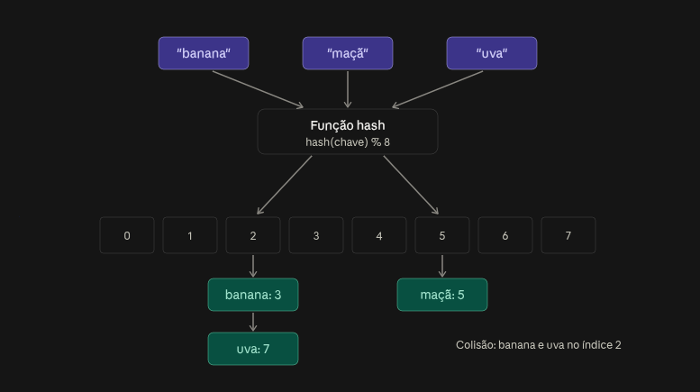

# Hash tables



## 1. A função hash

É uma função que recebe a chave e devolve um número. Uma versão bem simples (ruim na prática, mas boa para entender):

```javascript
function hash(chave, tamanho) {
  let soma = 0;
  for (const c of chave) soma += c.charCodeAt(0);
  return soma % tamanho; // garante um índice entre 0 e tamanho-1
}
```

O % tamanho é o que “encaixa” um número qualquer dentro dos limites do array. Uma boa função hash precisa de três propriedades: ser determinística (a mesma chave sempre gera o mesmo número, senão você nunca acharia o valor de volta), ser rápida, e espalhar bem as chaves pelo array. A minha função acima espalha mal: “ab” e “ba” dão a mesma soma. Funções reais (como **MurmurHash**, **xxHash**, **SipHash**) misturam os bits de forma muito mais caótica.

## 2. As operações

Para inserir ("banana", 3): calcula hash("banana"), vai no índice e guarda lá. Para buscar "banana": calcula o mesmo hash, vai no mesmo índice e pega o valor. Nenhuma das duas percorre a estrutura inteira, por isso são O(1) em média.

## 3. Colisões

Aqui está o ponto central. Existem infinitas chaves possíveis e só 8 posições, então duas chaves diferentes vão cair no mesmo índice inevitavelmente (é o princípio da casa dos pombos). No diagrama, “banana” e “uva” colidiram no índice 2. Existem duas estratégias principais para lidar com isso.

**Encadeamento (chaining)**: cada posição do array guarda uma lista. Colidiu, adiciona na lista. Na busca, você vai no índice e percorre a lista comparando as chaves:

```javascript
get(chave) {
  const balde = this.baldes[hash(chave, this.baldes.length)];
  const par = balde.find(([k]) => k === chave);
  return par ? par[1] : undefined;
}
```

Repare que a lista guarda a chave junto com o valor. Isso é obrigatório: como várias chaves dividem o balde, você precisa comparar para saber qual é a certa.

**Endereçamento aberto (open addressing)**: não existe lista. Se a posição está ocupada, você procura a próxima livre (índice 3, depois 4...), o que se chama linear probing. Na busca, você segue o mesmo caminho até achar a chave ou uma posição vazia. É mais amigável ao cache da CPU, porque tudo fica contíguo na memória, mas a remoção é chata: você não pode simplesmente esvaziar a posição, senão quebra o caminho de busca de outras chaves. Usa-se uma marca de “removido” (tombstone).

## 4. Fator de carga e redimensionamento

O fator de carga é quantidade de elementos ÷ tamanho do array. Quanto mais cheio, mais colisões, e as listas (ou os caminhos de busca) ficam longas, degradando para O(n). Por isso, quando o fator passa de um limite (tipicamente 0,75 em encadeamento, ou menos em endereçamento aberto), a tabela cria um array maior (geralmente o dobro) e reinsere todos os elementos, recalculando o hash de cada um, já que % tamanho mudou. Isso se chama **rehashing**.

Esse rehash custa O(n), mas acontece raramente, então o custo amortizado da inserção continua O(1). É exatamente o mesmo raciocínio do array dinâmico.

## 5. Complexidade
| Operação | Média	| Pior caso |
|   ---    |  ---   |   ---     | 
| Inserir  |	O(1)	|   O(n)    |
| Buscar	 |  O(1)	|   O(n)    |
| Remover	 |  O(1)	|   O(n)    |

O pior caso acontece quando todas as chaves caem no mesmo balde, por função hash ruim ou de propósito.

## Extra

- Ataques de **hash flooding**. Se um atacante sabe qual função hash você usa, ele pode mandar milhares de chaves que colidem (por exemplo, em parâmetros de uma requisição HTTP) e transformar seu servidor em O(n²). Por isso linguagens como Python e Rust usam hash com uma semente aleatória por processo (SipHash), e o Java converte baldes muito longos em árvores balanceadas, garantindo O(log n) no pior caso.

- Chaves mutáveis são perigosas. Se você usa um objeto como chave, insere, e depois muda o campo que entra no cálculo do hash, o objeto fica “perdido” num balde que não corresponde mais ao hash dele. Em Java, isso também implica que equals e hashCode precisam ser consistentes.

- No JavaScript. O Map é uma hash table de verdade e aceita qualquer tipo como chave (comparando objetos por referência). O objeto comum {} também funciona como uma, mas converte chaves para string e tem particularidades de protótipo, então para uso como dicionário o Map costuma ser a escolha certa. Um detalhe: tanto Map quanto {} preservam ordem de inserção na iteração, o que não é regra geral em hash tables (em Java, HashMap não garante ordem).

- Trade-off com outras estruturas. Hash table não suporta bem consultas por intervalo (“todos os usuários com idade entre 20 e 30”) nem ordenação. Para isso, árvores balanceadas ou B-trees são melhores, e é por isso que bancos de dados oferecem índices hash e índices B-tree. Saber escolher entre eles é exatamente o tipo de decisão que se espera de um sênior.
